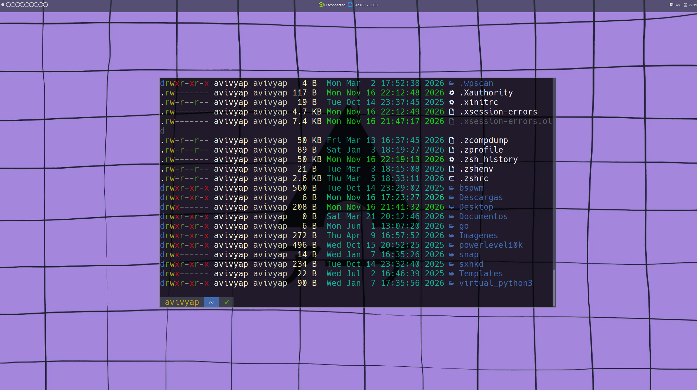

<div align="center">


# s1mple-Dotfiles

My Parrot / bspwm setup, installed with a single command.
<br>Mi entorno Parrot / bspwm, instalado con un solo comando.

`bspwm` · `sxhkd` · `polybar` · `picom` · `rofi` · `feh` · `zsh + powerlevel10k` · `tmux` · `MATE Terminal`

**[English](#english)** · **[Español](#español)**

</div>

---

# English

## Table of contents

- [Preview](#preview)
- [Quick install](#quick-install)
- [Compatibility](#compatibility)
- [Virtual machines](#virtual-machines)
- [Keybindings](#keybindings)
- [What it installs](#what-it-installs)
- [What the script does](#what-the-script-does)
- [After the installation](#after-the-installation)
- [Customization](#customization)
- [Changing the wallpaper](#changing-the-wallpaper)
- [Troubleshooting](#troubleshooting)
- [Restoring your old configuration](#restoring-your-old-configuration)
- [Repository structure](#repository-structure)
- [Credits](#credits)

---

## Preview

<p align="center">
  
</p>

The setup is a tiling desktop on bspwm with a transparent terminal, a polybar on top, a rofi launcher with the Arc-Dark theme and a zsh prompt with powerlevel10k and Nerd Font icons.

---

## Quick install

```bash
git clone https://github.com/avivyap/s1mple-Dotfiles
cd s1mple-Dotfiles
chmod +x install.sh
./install.sh
```

Run it as your **normal user**, not as root. It calls `sudo` only when it needs it, and it will ask for your password once at the start.

When it finishes, restart bspwm (`bspc wm -r`) or log out and back in, and pick the **bspwm** session at the login screen.

Requirements:

- A Debian-based system with `apt`.
- An internet connection.
- The repo folder as the current directory when you run the script (it needs `.config` and `bin` next to it).

---

## Compatibility

> **Tested on Parrot OS only.** It works on a Parrot virtual machine and on a laptop. On other distributions (Debian, Kali, Ubuntu...) it may not work as expected, because package names and versions can differ.

| Environment | Status |
|---|---|
| Parrot OS on a laptop | Works |
| Parrot OS in a virtual machine | Works, with 3D acceleration turned off |
| Debian, Kali, Ubuntu | Not tested, it may fail on some packages |

If a package is not available on your distribution, the script does not stop. It keeps going, marks the step with a warning and lists the missing packages at the end.

---

## Virtual machines

The setup works on a laptop and in a VM, but **in a VM you must turn off 3D acceleration**. With it on, picom causes graphic glitches, such as windows that do not repaint until you do something else, and the whole desktop feels slow.

In **VMware**:

1. Power off the VM completely.
2. Open **Edit virtual machine settings**.
3. Go to **Display**.
4. Untick **Accelerate 3D graphics**.
5. Start the VM again.

To check it, run `glxinfo -B | grep renderer`. If it says `llvmpipe`, 3D acceleration is off.

If it still fails, the installer asks whether to enable picom when it detects a VM. You can also decide without being asked:

```bash
PICOM_ON=0 ./install.sh
```

With `PICOM_ON=0`, picom is disabled and polybar uses pseudo-transparency instead.

The installer also adds the guest tools for the hypervisor it detects: `open-vm-tools-desktop` for VMware, `virtualbox-guest-x11` for VirtualBox and `spice-vdagent` with `qemu-guest-agent` for KVM/QEMU.

---

## Keybindings

`super` is the Windows key. Everything lives in `.config/sxhkdrc`.

### Apps

| Keys | Action |
|---|---|
| `super + Return` | Open the terminal |
| `ctrl + Return` | App launcher (rofi) |
| `super + Escape` | Lock the screen |

### Windows

| Keys | Action |
|---|---|
| `super + w` | Close the window |
| `super + shift + w` | Kill the window |
| `super + t` | Tiled |
| `super + shift + t` | Pseudo-tiled |
| `super + s` | Floating |
| `super + f` | Fullscreen |
| `super + m` | Switch between tiled and monocle layout |
| `super + g` | Swap with the biggest window |
| `super + c` / `super + shift + c` | Focus next / previous window |
| `super + ctrl + j k l i` | Focus the window to the left / down / up / right |
| `super + ctrl + shift + j k l i` | Swap with the window in that direction |
| `super + ctrl + j k i l` | Move a floating window |
| `alt + ctrl + j k i l` | Resize the window (script) |

### Desktops

| Keys | Action |
|---|---|
| `super + 1-9, 0` | Go to desktop 1-10 |
| `super + shift + 1-9, 0` | Send the window to desktop 1-10 |
| `super + [` / `super + ]` | Previous / next desktop |
| `super + Tab` | Last desktop |
| `super + grave` | Last window |

### Session

| Keys | Action |
|---|---|
| `super + alt + r` | Restart bspwm |
| `super + alt + q` | Quit bspwm |

## What it installs

| Component | What it does |
|---|---|
| bspwm + sxhkd | Window manager and keybindings (apt, compiled from source if apt does not have them) |
| polybar | Status bar, with my modules (`bin/` scripts) |
| picom | Compositor for transparencies |
| rofi | Launcher, with the Arc-Dark theme |
| feh | Wallpaper |
| zsh + powerlevel10k | Shell, prompt and plugins |
| zsh-syntax-highlighting | Command colouring in the prompt |
| tmux | oh-my-tmux config |
| MATE Terminal | Terminal profile (transparent background, Hack Nerd Font) |
| Hack Nerd Font | Font used by the terminal and the bar |
| bat, lsd | Better `cat` and `ls` |
| i3lock-fancy | Screen lock |
| Fonts | Cantarell, Unifont and Font Awesome, for the icons of the bar |
| Update script | `~/.actu.sh`, from the [.actu](https://github.com/avivyap/.actu) repo, used by the `update` function of zsh |

---

## What the script does

The installer runs these steps in order and prints one status line for each one (`ok`, `warnings` or `failed`):

1. **Updating package lists** with `apt-get update`.
2. **bspwm** and **sxhkd**: installs them, or compiles them if apt does not have them, and copies their configuration.
3. **Base configuration**: default rc files, permissions and `.xinitrc`.
4. **Wallpapers, rofi, picom, scripts**: installs `feh`, `rofi` and `picom`, copies the rofi theme, `picom.conf`, the scripts of `bin/` and the wallpapers.
5. **Fonts**: copies Hack Nerd Font to `/usr/local/share/fonts` and refreshes the font cache.
6. **Terminal and extra tools**: tmux, MATE Terminal, the guest tools of your VM and the terminal profile.
7. **polybar**: installs it (or compiles it) and copies the config and the launcher.
8. **zsh, powerlevel10k**: installs zsh, clones powerlevel10k, copies `.zshrc` and `.p10k.zsh` and sets zsh as your shell.
9. **tmux**: clones oh-my-tmux.
10. **bat**: installs it from the included `.deb` on amd64, or from apt.
11. **Update script**: clones `.actu` and links it as `~/.actu.sh`.
12. **Verification**: checks 26 things (programs, config files, fonts, wallpaper, shell) and prints a summary.

Other details:

- The output is quiet. The full details go to `~/install-dotfiles.log`.
- **Anything it replaces is backed up** to `~/dotfiles-backup-<date>`, so you can run the script more than once.
- It copies the configs to `~/.config`, the scripts to `~/.config/bin` and the wallpapers to `~/wallpaper`.
- It changes the absolute `/home/avivyap/` paths of the polybar config to your own home.
- It links `mate-terminal` as the `gnome-terminal` command, because the keybindings use that name.

---

## After the installation

1. Restart bspwm (`bspc wm -r`) or log out and log in again, choosing the bspwm session.
2. Open a terminal with `super + Return`. The first time, zsh may start the powerlevel10k wizard. If you want the same prompt as in the preview, use the included `.p10k.zsh` and skip it.
3. Open the launcher with `ctrl + Return` and check that rofi has the Arc-Dark theme.
4. If something looks off, run `~/.config/polybar/launch.sh` to relaunch the bar and look at the troubleshooting section below.

---

## Customization

| What | Where |
|---|---|
| Keybindings | `~/.config/sxhkd/sxhkdrc` (reload with `pkill -USR1 -x sxhkd`) |
| Window gaps, borders, desktops, startup apps | `~/.config/bspwm/bspwmrc` |
| Wallpaper | the `feh` line of `bspwmrc` (see [Changing the wallpaper](#changing-the-wallpaper)) |
| Bar modules and colours | `~/.config/polybar/config` |
| Bar scripts | `~/.config/bin` |
| Transparencies and shadows | `~/.config/picom.conf` |
| Launcher theme | `~/.config/rofi/theme/Arc-Dark.rasi` |
| Prompt | `~/.p10k.zsh` (or run `p10k configure`) |
| Terminal profile | MATE Terminal preferences, or edit `.config/mate-terminal.dconf` and load it with `dconf load /org/mate/terminal/ < .config/mate-terminal.dconf` |

To change the wallpaper, replace the file name in the `feh --bg-fill` line of `bspwmrc` with any image of `~/wallpaper`.

---

## Changing the wallpaper

The wallpapers are copied to `~/wallpaper` during the installation. The ones included in the repo are: `a.png`, `animelike.png`, `archkali.png`, `b.png`, `coche_amarillo.png`, `lofi-pixel.jpg`, `narutoog.jpg`, `purple-tree.jpg`, `test.png`, `wall-05.png`, `wall-07.webp`, `wall-09.webp`, `wall-10.webp` and `wallpaperarch.png`.

**Try one right now** (it lasts until you restart bspwm):

```bash
feh --bg-fill ~/wallpaper/archkali.png
```

**Make it permanent.** Open `~/.config/bspwm/bspwmrc`, find the `feh` line and change the file name:

```bash
feh --bg-fill /home/$USER/wallpaper/a.png
```

For example, replace `a.png` with `purple-tree.jpg`. Then restart bspwm with `bspc wm -r`.

**Use your own image.** Copy it to `~/wallpaper` and use its name in the `feh` line:

```bash
cp ~/Downloads/my-image.png ~/wallpaper/
feh --bg-fill ~/wallpaper/my-image.png
```

`--bg-fill` fills the whole screen and crops what does not fit. Other modes are `--bg-scale` (stretches the image), `--bg-center` (centered, no scaling) and `--bg-max` (fits the image inside the screen, with borders).

If you want the change to survive a new installation, also edit the `feh` line in `.config/bspwm/bspwmrc` of the repo, and put your image in the `wallpapers/` folder before you run `./install.sh`. The installer replaces `bspwmrc` with the one from the repo (it saves your old one in `~/dotfiles-backup-<date>`).

If a `.webp` image does not load, convert it to PNG (for example with `convert image.webp image.png` from ImageMagick).

---

## Troubleshooting

**Every package fails to install.** Apt is probably locked by another process (automatic updates on a freshly started machine) or there is no network. Run `sudo apt-get update` and check the error, then run the script again. The full error is in `~/install-dotfiles.log`.

**The desktop is slow or windows do not repaint.** You are probably in a VM with 3D acceleration on. Turn it off (see [Virtual machines](#virtual-machines)). As a quick test, run `killall picom`: if the problem disappears, it is picom.

**polybar does not appear.** Launch it by hand to see the error:

```bash
polybar -l info -c ~/.config/polybar/config parrot
```

The launcher writes its output to `/tmp/polybar.log`.

**A module of the bar is empty.** Check that the scripts of `~/.config/bin` are executable (`chmod +x ~/.config/bin/*`).

**The icons show as squares.** The Nerd Font is not loaded. Run `fc-cache -f` and check it with `fc-list | grep -i "hack nerd"`.

**The terminal is white or opaque.** Load the profile again:

```bash
dconf load /org/mate/terminal/ < .config/mate-terminal.dconf
```

**bspwm does not show up at the login screen.** On some display managers you have to click the gear icon next to the login button and choose the **bspwm** session.

**Something failed during the install.** The script prints a summary with the failed checks and packages. Fix the cause and run it again: it only installs what is missing.

---

## Restoring your old configuration

Every file the installer replaced is saved in `~/dotfiles-backup-<date>`, keeping its original path. To go back to one of them, copy it to its place, for example:

```bash
cp ~/dotfiles-backup-<date>/.config/picom.conf ~/.config/picom.conf
```

---

## Repository structure

```
.
├── install.sh              installer
├── README.md
├── assets/                 images of this README
├── .config/
│   ├── bspwm/              bspwmrc and scripts
│   ├── polybar/            bar config
│   ├── sxhkdrc             keybindings
│   ├── picom.conf          compositor
│   ├── Arc-Dark.rasi       rofi theme
│   ├── mate-terminal.dconf terminal profile
│   ├── p10k.zsh            powerlevel10k
│   ├── zshrc               zsh config
│   └── .xinitrc
├── bin/                    scripts used by polybar
├── fonts/                  Hack Nerd Font
└── wallpapers/
```

---

## Credits

- [powerlevel10k](https://github.com/romkatv/powerlevel10k) by romkatv
- [oh-my-tmux](https://github.com/gpakosz/.tmux) by gpakosz
- Everything else in this repo is built on top of Parrot OS.

---

# Español

## Índice

- [Vista previa](#vista-previa)
- [Instalación rápida](#instalación-rápida)
- [Compatibilidad](#compatibilidad)
- [Máquinas virtuales](#máquinas-virtuales)
- [Atajos de teclado](#atajos-de-teclado)
- [Qué instala](#qué-instala)
- [Qué hace el script](#qué-hace-el-script)
- [Después de la instalación](#después-de-la-instalación)
- [Personalización](#personalización)
- [Cambiar el fondo de pantalla](#cambiar-el-fondo-de-pantalla)
- [Solución de problemas](#solución-de-problemas)
- [Restaurar tu configuración anterior](#restaurar-tu-configuración-anterior)
- [Estructura del repositorio](#estructura-del-repositorio)
- [Créditos](#créditos)

---

## Vista previa

<p align="center">
  
</p>

El entorno es un escritorio en mosaico sobre bspwm, con una terminal transparente, una polybar arriba, un lanzador rofi con el tema Arc-Dark y un prompt de zsh con powerlevel10k e iconos Nerd Font.

---

## Instalación rápida

```bash
git clone https://github.com/avivyap/s1mple-Dotfiles
cd s1mple-Dotfiles
chmod +x install.sh
./install.sh
```

Ejecútalo con tu **usuario normal**, no como root. Usa `sudo` solo cuando lo necesita y te pedirá la contraseña una vez al principio.

Cuando termine, reinicia bspwm (`bspc wm -r`) o cierra sesión y vuelve a entrar, eligiendo la sesión **bspwm** en la pantalla de login.

Requisitos:

- Un sistema basado en Debian con `apt`.
- Conexión a internet.
- La carpeta del repo como directorio actual al ejecutar el script (necesita `.config` y `bin` a su lado).

---

## Compatibilidad

> **Probado solo en Parrot OS.** Funciona en una máquina virtual de Parrot y en un portátil. En otras distribuciones (Debian, Kali, Ubuntu...) puede no funcionar como se espera, porque los nombres y las versiones de los paquetes pueden cambiar.

| Entorno | Estado |
|---|---|
| Parrot OS en un portátil | Funciona |
| Parrot OS en una máquina virtual | Funciona, con la aceleración 3D desactivada |
| Debian, Kali, Ubuntu | Sin probar, puede fallar en algunos paquetes |

Si un paquete no está disponible en tu distribución, el script no se detiene. Sigue adelante, marca el paso con un aviso y lista los paquetes que faltan al final.

---

## Máquinas virtuales

El entorno funciona en un portátil y en una VM, pero **en una VM tienes que desactivar la aceleración 3D**. Con ella activada, picom provoca fallos gráficos, como ventanas que no se repintan hasta que haces otra cosa, y todo el escritorio va lento.

En **VMware**:

1. Apaga la VM por completo.
2. Abre **Edit virtual machine settings**.
3. Ve a **Display**.
4. Desmarca **Accelerate 3D graphics**.
5. Arranca la VM de nuevo.

Para comprobarlo, ejecuta `glxinfo -B | grep renderer`. Si pone `llvmpipe`, la aceleración 3D está desactivada.

Si aun así falla, el instalador te pregunta si quieres activar picom cuando detecta una VM. También puedes decidirlo sin que te pregunte:

```bash
PICOM_ON=0 ./install.sh
```

Con `PICOM_ON=0`, picom se desactiva y polybar usa pseudo-transparencia.

El instalador añade además las herramientas de invitado del hipervisor que detecta: `open-vm-tools-desktop` para VMware, `virtualbox-guest-x11` para VirtualBox y `spice-vdagent` con `qemu-guest-agent` para KVM/QEMU.

---

## Atajos de teclado

`super` es la tecla de Windows. Todo está en `.config/sxhkdrc`.

### Aplicaciones

| Teclas | Acción |
|---|---|
| `super + Return` | Abrir la terminal |
| `ctrl + Return` | Lanzador de aplicaciones (rofi) |
| `super + Escape` | Bloquear la pantalla |

### Ventanas

| Teclas | Acción |
|---|---|
| `super + w` | Cerrar la ventana |
| `super + shift + w` | Matar la ventana |
| `super + t` | En mosaico |
| `super + shift + t` | Pseudo-mosaico |
| `super + s` | Flotante |
| `super + f` | Pantalla completa |
| `super + m` | Cambiar entre mosaico y monocle |
| `super + g` | Intercambiar con la ventana más grande |
| `super + c` / `super + shift + c` | Enfocar la ventana siguiente / anterior |
| `super + ctrl + j k l i` | Enfocar la ventana a la izquierda / abajo / arriba / derecha |
| `super + ctrl + shift + j k l i` | Intercambiar con la ventana en esa dirección |
| `super + ctrl + j k i l` | Mover una ventana flotante |
| `alt + ctrl + j k i l` | Cambiar el tamaño de la ventana (script) |

### Escritorios

| Teclas | Acción |
|---|---|
| `super + 1-9, 0` | Ir al escritorio 1-10 |
| `super + shift + 1-9, 0` | Enviar la ventana al escritorio 1-10 |
| `super + [` / `super + ]` | Escritorio anterior / siguiente |
| `super + Tab` | Último escritorio |
| `super + grave` | Última ventana |

### Sesión

| Teclas | Acción |
|---|---|
| `super + alt + r` | Reiniciar bspwm |
| `super + alt + q` | Salir de bspwm |

---

## Qué instala

| Componente | Para qué sirve |
|---|---|
| bspwm + sxhkd | Gestor de ventanas y atajos (con apt, o compilado desde el código si apt no los tiene) |
| polybar | Barra de estado, con mis módulos (scripts de `bin/`) |
| picom | Compositor para las transparencias |
| rofi | Lanzador, con el tema Arc-Dark |
| feh | Fondo de pantalla |
| zsh + powerlevel10k | Shell, prompt y plugins |
| zsh-syntax-highlighting | Colores en los comandos del prompt |
| tmux | Configuración oh-my-tmux |
| MATE Terminal | Perfil de terminal (fondo transparente, Hack Nerd Font) |
| Hack Nerd Font | Fuente de la terminal y de la barra |
| bat, lsd | Mejores `cat` y `ls` |
| i3lock-fancy | Bloqueo de pantalla |
| Fuentes | Cantarell, Unifont y Font Awesome, para los iconos de la barra |
| Script de actualización | `~/.actu.sh`, del repo [.actu](https://github.com/avivyap/.actu), que usa la función `update` de zsh |

---

## Qué hace el script

El instalador ejecuta estos pasos en orden y muestra una línea de estado por cada uno (`ok`, `warnings` o `failed`):

1. **Updating package lists:** `apt-get update`.
2. **bspwm** y **sxhkd:** los instala, o los compila si apt no los tiene, y copia su configuración.
3. **Base configuration:** archivos rc por defecto, permisos y `.xinitrc`.
4. **Wallpapers, rofi, picom, scripts:** instala `feh`, `rofi` y `picom`, copia el tema de rofi, `picom.conf`, los scripts de `bin/` y los fondos de pantalla.
5. **Fonts:** copia Hack Nerd Font a `/usr/local/share/fonts` y actualiza la caché de fuentes.
6. **Terminal and extra tools:** tmux, MATE Terminal, las herramientas de invitado de tu VM y el perfil de la terminal.
7. **polybar:** la instala (o la compila) y copia la configuración y el lanzador.
8. **zsh, powerlevel10k:** instala zsh, clona powerlevel10k, copia `.zshrc` y `.p10k.zsh` y pone zsh como tu shell.
9. **tmux:** clona oh-my-tmux.
10. **bat:** lo instala desde el `.deb` incluido en amd64, o desde apt.
11. **Update script:** clona `.actu` y lo enlaza como `~/.actu.sh`.
12. **Verification:** comprueba 26 cosas (programas, archivos de configuración, fuentes, fondo de pantalla, shell) y muestra un resumen.

Otros detalles:

- La salida es discreta. Los detalles completos van a `~/install-dotfiles.log`.
- **Todo lo que reemplaza se guarda antes** en `~/dotfiles-backup-<fecha>`, así que puedes ejecutar el script más de una vez.
- Copia las configuraciones a `~/.config`, los scripts a `~/.config/bin` y los fondos de pantalla a `~/wallpaper`.
- Cambia las rutas absolutas `/home/avivyap/` de la configuración de polybar por tu propio home.
- Enlaza `mate-terminal` como el comando `gnome-terminal`, porque los atajos usan ese nombre.

---

## Después de la instalación

1. Reinicia bspwm (`bspc wm -r`) o cierra sesión y vuelve a entrar, eligiendo la sesión bspwm.
2. Abre una terminal con `super + Return`. La primera vez, zsh puede lanzar el asistente de powerlevel10k. Si quieres el mismo prompt que en la vista previa, usa el `.p10k.zsh` incluido y sáltate el asistente.
3. Abre el lanzador con `ctrl + Return` y comprueba que rofi tiene el tema Arc-Dark.
4. Si algo se ve mal, ejecuta `~/.config/polybar/launch.sh` para relanzar la barra y mira la sección de solución de problemas.

---

## Personalización

| Qué | Dónde |
|---|---|
| Atajos de teclado | `~/.config/sxhkd/sxhkdrc` (recarga con `pkill -USR1 -x sxhkd`) |
| Separación y bordes de ventanas, escritorios, aplicaciones al inicio | `~/.config/bspwm/bspwmrc` |
| Fondo de pantalla | la línea de `feh` de `bspwmrc` (mira [Cambiar el fondo de pantalla](#cambiar-el-fondo-de-pantalla)) |
| Módulos y colores de la barra | `~/.config/polybar/config` |
| Scripts de la barra | `~/.config/bin` |
| Transparencias y sombras | `~/.config/picom.conf` |
| Tema del lanzador | `~/.config/rofi/theme/Arc-Dark.rasi` |
| Prompt | `~/.p10k.zsh` (o ejecuta `p10k configure`) |
| Perfil de la terminal | Preferencias de MATE Terminal, o edita `.config/mate-terminal.dconf` y cárgalo con `dconf load /org/mate/terminal/ < .config/mate-terminal.dconf` |

Para cambiar el fondo de pantalla, sustituye el nombre del archivo en la línea `feh --bg-fill` de `bspwmrc` por cualquier imagen de `~/wallpaper`.

---

## Cambiar el fondo de pantalla

Los fondos se copian a `~/wallpaper` durante la instalación. Los que trae el repo son: `a.png`, `animelike.png`, `archkali.png`, `b.png`, `coche_amarillo.png`, `lofi-pixel.jpg`, `narutoog.jpg`, `purple-tree.jpg`, `test.png`, `wall-05.png`, `wall-07.webp`, `wall-09.webp`, `wall-10.webp` y `wallpaperarch.png`.

**Probar uno ahora mismo** (dura hasta que reinicies bspwm):

```bash
feh --bg-fill ~/wallpaper/archkali.png
```

**Dejarlo fijo.** Abre `~/.config/bspwm/bspwmrc`, busca la línea de `feh` y cambia el nombre del archivo:

```bash
feh --bg-fill /home/$USER/wallpaper/a.png
```

Por ejemplo, cambia `a.png` por `purple-tree.jpg`. Después reinicia bspwm con `bspc wm -r`.

**Usar tu propia imagen.** Cópiala a `~/wallpaper` y pon su nombre en la línea de `feh`:

```bash
cp ~/Descargas/mi-imagen.png ~/wallpaper/
feh --bg-fill ~/wallpaper/mi-imagen.png
```

`--bg-fill` rellena toda la pantalla y recorta lo que no cabe. Otros modos son `--bg-scale` (estira la imagen), `--bg-center` (centrada, sin escalar) y `--bg-max` (ajusta la imagen dentro de la pantalla, con bordes).

Si quieres que el cambio sobreviva a una instalación nueva, edita también la línea de `feh` en `.config/bspwm/bspwmrc` del repo y pon tu imagen en la carpeta `wallpapers/` antes de ejecutar `./install.sh`. El instalador reemplaza `bspwmrc` por el del repo (guarda el tuyo en `~/dotfiles-backup-<fecha>`).

Si una imagen `.webp` no carga, conviértela a PNG (por ejemplo con `convert imagen.webp imagen.png`, de ImageMagick).

---

## Solución de problemas

**Todos los paquetes fallan al instalarse.** Probablemente apt está bloqueado por otro proceso (actualizaciones automáticas en una máquina recién arrancada) o no hay red. Ejecuta `sudo apt-get update`, mira el error y vuelve a lanzar el script. El error completo está en `~/install-dotfiles.log`.

**El escritorio va lento o las ventanas no se repintan.** Seguramente estás en una VM con la aceleración 3D activada. Desactívala (mira [Máquinas virtuales](#máquinas-virtuales)). Como prueba rápida, ejecuta `killall picom`: si el problema desaparece, es picom.

**polybar no aparece.** Lánzala a mano para ver el error:

```bash
polybar -l info -c ~/.config/polybar/config parrot
```

El lanzador escribe su salida en `/tmp/polybar.log`.

**Un módulo de la barra sale vacío.** Comprueba que los scripts de `~/.config/bin` son ejecutables (`chmod +x ~/.config/bin/*`).

**Los iconos salen como cuadrados.** La Nerd Font no está cargada. Ejecuta `fc-cache -f` y compruébalo con `fc-list | grep -i "hack nerd"`.

**La terminal sale blanca u opaca.** Carga el perfil otra vez:

```bash
dconf load /org/mate/terminal/ < .config/mate-terminal.dconf
```

**bspwm no aparece en la pantalla de login.** En algunos gestores de sesión tienes que pulsar el icono del engranaje junto al botón de entrar y elegir la sesión **bspwm**.

**Algo falló durante la instalación.** El script muestra un resumen con las comprobaciones y los paquetes que fallaron. Arregla la causa y ejecútalo otra vez: solo instala lo que falta.

---

## Restaurar tu configuración anterior

Cada archivo que el instalador reemplazó se guarda en `~/dotfiles-backup-<fecha>`, conservando su ruta original. Para volver a uno de ellos, cópialo a su sitio, por ejemplo:

```bash
cp ~/dotfiles-backup-<fecha>/.config/picom.conf ~/.config/picom.conf
```

---

## Estructura del repositorio

```
.
├── install.sh              instalador
├── README.md
├── assets/                 imágenes de este README
├── .config/
│   ├── bspwm/              bspwmrc y scripts
│   ├── polybar/            configuración de la barra
│   ├── sxhkdrc             atajos de teclado
│   ├── picom.conf          compositor
│   ├── Arc-Dark.rasi       tema de rofi
│   ├── mate-terminal.dconf perfil de la terminal
│   ├── p10k.zsh            powerlevel10k
│   ├── zshrc               configuración de zsh
│   └── .xinitrc
├── bin/                    scripts que usa polybar
├── fonts/                  Hack Nerd Font
└── wallpapers/             fondos de pantalla
```

---

## Créditos

- [powerlevel10k](https://github.com/romkatv/powerlevel10k) de romkatv
- [oh-my-tmux](https://github.com/gpakosz/.tmux) de gpakosz
- Todo lo demás de este repo está construido sobre Parrot OS.
