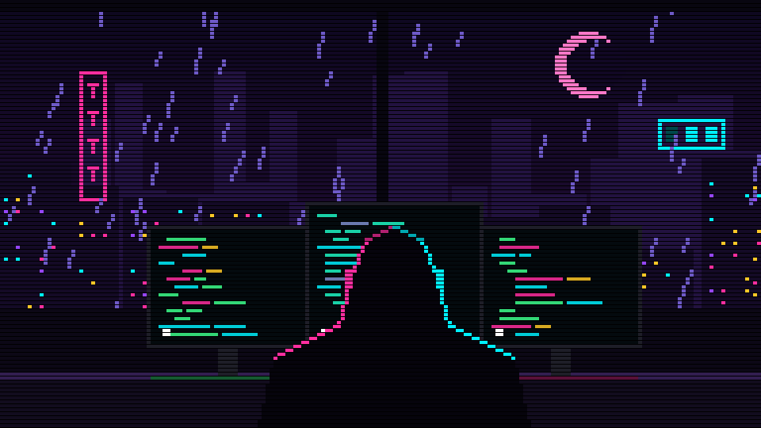

<div align="center">



# s1mple-Dotfiles

My Parrot / bspwm setup, installed with a single command.

`bspwm` · `sxhkd` · `polybar` · `picom` · `rofi` · `feh` · `zsh + powerlevel10k` · `tmux` · `MATE Terminal`

</div>

---

## Preview

<p align="center">
  
</p>

## Quick install

```bash
git clone https://github.com/avivyap/s1mple-Dotfiles
cd s1mple-Dotfiles
chmod +x install.sh
./install.sh
```

Run it as your **normal user**, not as root. It calls `sudo` only when it needs it. When it finishes, restart bspwm (`bspc wm -r`) or log out and back in, and pick the **bspwm** session at the login screen.

Requirements: a Debian-based system with `apt` and an internet connection.

> **Tested on Parrot OS only.** It works on a Parrot virtual machine and on a laptop. On other distributions (Debian, Kali, Ubuntu...) it may not work as expected, because package names and versions can differ.

## Keybindings

`super` is the Windows key. Everything lives in `.config/sxhkdrc`.

### Apps

| Keys | Action |
|---|---|
| `super + Return` | Open the terminal |
| `ctrl + Return` | App launcher (rofi) |
| `super + Escape` | Lock the screen |

### Windows

| Keys | Action |
|---|---|
| `super + w` | Close the window |
| `super + shift + w` | Kill the window |
| `super + t` | Tiled |
| `super + shift + t` | Pseudo-tiled |
| `super + s` | Floating |
| `super + f` | Fullscreen |
| `super + m` | Switch between tiled and monocle layout |
| `super + g` | Swap with the biggest window |
| `super + c` / `super + shift + c` | Focus next / previous window |
| `super + ctrl + j k l i` | Focus the window to the left / down / up / right |
| `super + ctrl + shift + j k l i` | Swap with the window in that direction |
| `super + ctrl + j k i l` | Move a floating window |
| `alt + ctrl + j k i l` | Resize the window (script) |

### Desktops

| Keys | Action |
|---|---|
| `super + 1-9, 0` | Go to desktop 1-10 |
| `super + shift + 1-9, 0` | Send the window to desktop 1-10 |
| `super + [` / `super + ]` | Previous / next desktop |
| `super + Tab` | Last desktop |
| `super + grave` | Last window |

### Session

| Keys | Action |
|---|---|
| `super + alt + r` | Restart bspwm |
| `super + alt + q` | Quit bspwm |

## What it installs

| Component | What it does |
|---|---|
| bspwm + sxhkd | Window manager and keybindings (apt, compiled from source if apt does not have them) |
| polybar | Status bar, with my modules (`bin/` scripts) |
| picom | Compositor for transparencies |
| rofi | Launcher, with the Arc-Dark theme |
| feh | Wallpaper |
| zsh + powerlevel10k | Shell, prompt and plugins |
| tmux | oh-my-tmux config |
| MATE Terminal | Terminal profile (transparent background, Hack Nerd Font) |
| Hack Nerd Font | Font used by the terminal and the bar |
| bat, lsd | Better `cat` and `ls` |

## What the script does

- Installs the packages quietly and prints one status line per step. The full details go to `~/install-dotfiles.log`.
- **Backs up** anything it replaces to `~/dotfiles-backup-<date>`, so you can run it more than once.
- Copies the configs to `~/.config`, the scripts to `~/.config/bin` and the wallpapers to `~/wallpaper`.
- Detects virtual machines and installs the matching guest tools (VMware, VirtualBox, KVM/QEMU).
- Finishes with a check of the whole setup, listing anything that failed.

## Virtual machines

The setup works on a laptop and in a VM, but **in a VM you must turn off 3D acceleration**. With it on, picom causes graphic glitches, such as windows that do not repaint until you do something else. In **VMware**, turn off **Accelerate 3D graphics** in the VM settings (with the VM powered off).

If it still fails, the installer asks whether to enable picom when it detects a VM. You can also decide without being asked:

```bash
PICOM_ON=0 ./install.sh
```

With `PICOM_ON=0`, picom is disabled and polybar uses pseudo-transparency.

## Structure

```
.
├── install.sh        installer
├── .config/          bspwm, sxhkd, polybar, picom, rofi theme, zsh, terminal profile
├── bin/              scripts used by polybar
├── fonts/            Hack Nerd Font
└── wallpapers/
```

## Credits

- [powerlevel10k](https://github.com/romkatv/powerlevel10k) by romkatv
- [oh-my-tmux](https://github.com/gpakosz/.tmux) by gpakosz
- Everything else in this repo is built on top of Parrot OS.
